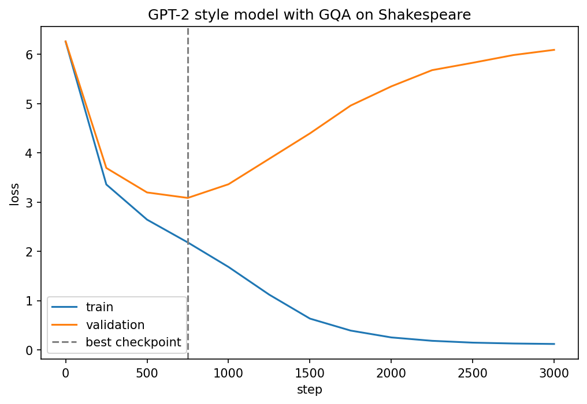

# GPT-2 style language model with Grouped-Query Attention and a from-scratch BPE tokenizer

A small GPT-2 style language model built step by step in PyTorch and trained on the Tiny Shakespeare dataset. It follows the structure of Andrej Karpathy's GPT-2 code-along, with two changes:

1. **Grouped-query attention (GQA)** instead of standard multi-head attention.
2. **A byte-pair encoding (BPE) tokenizer written from scratch** and trained on the Shakespeare text, instead of the pre-trained GPT-2 tokenizer.

Everything lives in one notebook, `gpt2_gqa.ipynb`, with explanatory cells and the outputs of the run.

## Files

| File | What it is |
| --- | --- |
| `gpt2_gqa.ipynb` | The full notebook: tokenizer, model, training, plots, generation |
| `merges.pkl` | The learned BPE merge rules (the trained tokenizer) |
| `gpt_gqa_best.pt` | Weights of the best checkpoint (lowest validation loss) |
| `loss_curve.png` | Train and validation loss during training |
| `samples.txt` | Text generated by the best checkpoint |

## 1. BPE tokenizer (from scratch)

- Starts from raw UTF-8 bytes (token IDs 0 to 255), so any text can be encoded.
- Repeatedly counts adjacent token pairs, merges the most frequent pair into a new token, and records the rule.
- 256 merges, giving a vocabulary of **512 tokens**.
- Compresses the dataset from 1,115,394 bytes to **568,210 tokens** (about 1.96 bytes per token).
- `decode(encode(text)) == text` is checked on the data.
- Merges learn real structure, for example `" the "`, `", and "`, and the `":\n"` that ends a speaker label.

## 2. Model

| Setting | Value |
| --- | --- |
| Layers | 6 |
| Embedding size | 384 |
| Query heads | 6 (head size 64) |
| Key/value heads | **2** (3 query heads share each KV head) |
| Context length | 256 tokens |
| Vocabulary | 512 |
| Parameters | 9,742,080 |

Architecture, as in GPT-2: learned token and position embeddings, pre-norm transformer blocks with residual connections, causal self-attention, an MLP with GELU (4x width), a final layer norm, and an output layer whose weights are tied to the token embedding. Weights are initialized with std 0.02, and the residual output projections are scaled by 1/sqrt(2 x layers). Biases are left out.

### What GQA changes

In standard multi-head attention every query head has its own key and value head. In GQA, the 6 query heads are split into 2 groups of 3, and each group shares one key/value head.

- The query projection stays 384 wide, but the key and value projections shrink from 384 to 2 x 64 = **128**.
- Before the attention scores are computed, each KV head is repeated 3 times so it lines up with the query heads.
- Attention parameters per layer: **393,216**, against 589,824 for standard multi-head attention at this size, a reduction of one third.
- The key/value cache needed during generation is also 3 times smaller.

The attention layer is checked in the notebook: changing only the last token leaves all earlier outputs unchanged (the causal mask works), and the output matches PyTorch's `scaled_dot_product_attention`.

## 3. Training

| Setting | Value |
| --- | --- |
| Data | Tiny Shakespeare, 568,210 tokens: 90% train (511,389), 10% validation (56,821) |
| Batch | 32 sequences x 256 tokens |
| Optimizer | AdamW, betas (0.9, 0.95), weight decay 0.1 on weight matrices only |
| Learning rate | 1e-3 peak, 100 warmup steps, cosine decay to 1e-4 |
| Gradient clipping | 1.0 |
| Steps | 3,000 |
| Hardware | One Tesla T4 on Google Colab, about 0.18 s per step (about 10 minutes in total) |

Before the full run, the model was checked by overfitting a single batch (loss from 6.3 to 0.002) and by confirming that the starting loss is close to ln(512) = 6.24.

## 4. Results



| Step | Train loss | Validation loss |
| --- | --- | --- |
| 0 | 6.26 | 6.26 |
| 250 | 3.36 | 3.69 |
| 500 | 2.64 | 3.20 |
| **750** | 2.18 | **3.08** |
| 1000 | 1.68 | 3.36 |
| 1500 | 0.63 | 4.40 |
| 2000 | 0.25 | 5.35 |
| 2999 | 0.12 | 6.09 |

**Overfitting.** Validation loss is lowest at step 750 (3.085) and then rises while the training loss keeps falling to 0.12. The model has 9.7M parameters but sees only about 511k training tokens, and 3,000 steps are about 48 passes over the data, so after roughly 12 passes it starts memorizing. The checkpoint with the best validation loss is saved during training and used for all generated text. Possible fixes are dropout, a smaller model, or more data.

## 5. Generated text

Generated from `gpt_gqa_best.pt` with temperature 0.8, top-k 40 and seed 1337. Full output is in `samples.txt`.

```
KING HENRY:
My lord, I say, how shall not find.

BUCKINGHAM:
Farewell, my lord. What murder me, my lord?

HASTINGS:
My lord, to me here?
```

The model has clearly learned the format of a play: capitalised speaker names, colons, short speeches and blank lines between them. It also learned which characters appear together. The text often drifts in meaning and contains invented words, because the model is small, the vocabulary is only 512 tokens and the dataset is about 1 MB.

## How to run

1. Open `gpt2_gqa.ipynb` in Google Colab with a T4 GPU (or locally, but training is about 45 times slower on a CPU).
2. Upload `input.txt` (Tiny Shakespeare) next to the notebook:
   `https://raw.githubusercontent.com/karpathy/char-rnn/master/data/tinyshakespeare/input.txt`
3. Requirements: `torch`, `matplotlib`.
4. Run all cells. To only generate text, run the cells that define the tokenizer and the model, load `gpt_gqa_best.pt` with `model.load_state_dict(...)`, and call `generate(...)`.

## Acknowledgements

Based on Andrej Karpathy's "Let's reproduce GPT-2 (124M)" and "Let's build the GPT Tokenizer" videos. Dataset: Tiny Shakespeare.
